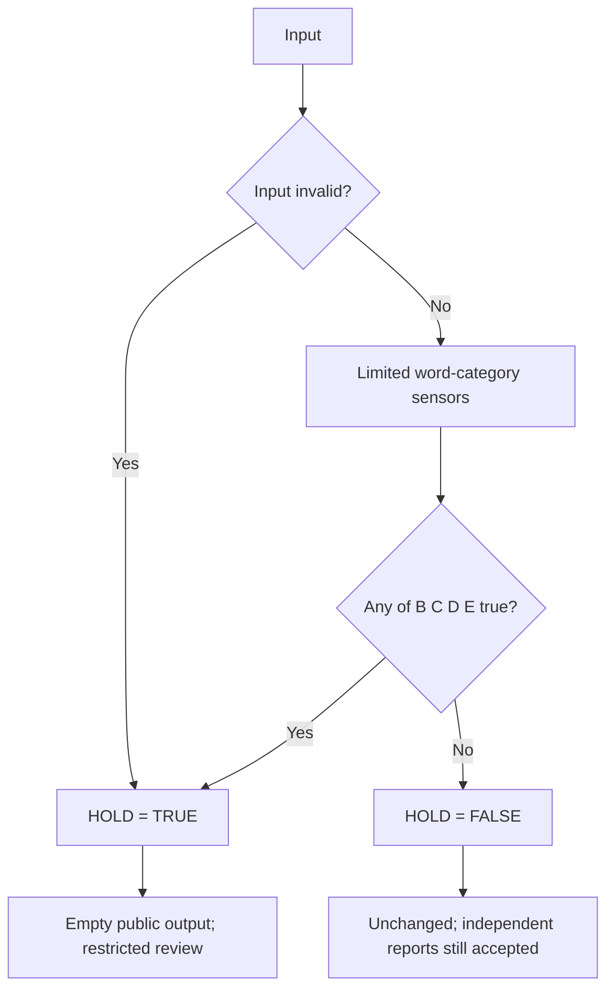

# Pentagon XOR · One-Bit Content Gate

> **FOR EVALUATION PURPOSES · NO WARRANTY · NO COPYRIGHT CLAIM · NO TRADEMARK CLAIM · NO INSURANCE · ONLY BEST EFFORT SELF DIRECTED AGENCY LOGIC**

**Experimental, limited English text filter. Not a certified CSAM/CSAE detector, legal verdict, or substitute for human review.** A `false` bit is not clearance; a `true` bit is not evidence of criminality.

## The entire public-output decision

```text
HOLD = A OR B OR C OR D OR E

A = Invalid input
B = Direct exploitation terminology
C = Age AND (Sexual OR Coercion)
D = Age AND ((Secrecy AND Contact) OR (Media AND Request))
E = Sexual AND Coercion

HOLD true  => public text = "" ; restricted local review
HOLD false => original public text ; independent reporting still available
```

No numerical scoring, word-by-word disguise, or additional public-output decision.



### Pentagonal XOR: a proof, not a dangerous shortcut

`OR5` is the simplest protective comb. `XOR5` alone is **not** equivalent because simultaneous signals can cancel. The exhaustive 32-state identity used in the test suite is:

```text
OR5 = (A XOR B XOR C XOR D XOR E) OR (two-or-more inputs are TRUE)
```

The production path uses **OR5**, not the longer identity. The five inputs are grouped intermediate conditions, **one final Boolean is stored**.

### Intentionally limited vocabulary

The code's exact regexes are the canonical implementation. The sensors cover: **AGE** (child/minor/teen and example age formats), **SEXUAL** (sexual context and intimate-media terms), **MEDIA** (photo/video/picture slang), **REQUEST** (send/share/trade), **SECRECY** (secret/private/quietly), **CONTACT** (DM/PM/private message), **COERCION** (blackmail/extortion/threats), and **DIRECT** (CSAM/CSAE and abuse terminology). These examples are **non-exhaustive**, English-centric, and vulnerable to obfuscation, contextual errors, and false positives.

Validation requires well-formed UTF-8 and input length no greater than 32 KiB per record; normalizing requires NFKC where available. Oversized, invalid, or processing-error input is held. Processing is per-record, not full-thread context.

## Run the offline evaluator

Keep `powershell/Protect-Archive-SingleBit.ps1` in the same folder as `all_threads_dump.txt` (or provide an explicit path). One input line is treated as one record.

```powershell
pwsh.exe -NoLogo -NoProfile -ExecutionPolicy Bypass -File .\Protect-Archive-SingleBit.ps1
```

The original file stays unchanged. Outputs are a uniquely named sanitized file and a local audit with record number, **one `hold` Boolean**, and policy version `3.1.0-pentagon`. Nothing is uploaded to Datadog, GitHub, or other services. For a multi-line post archive, use a record-aware importer rather than treating each line as an independent post.

## Deploying the examples

- [PHP 8+ gate](php/SingleBitGate.php) and [CGI sample](php/cgi-bin/post.php)
- [Ruby/Rails gate](ruby/app/services/single_bit_gate.rb), [controller](ruby/app/controllers/posts_controller.rb), models and example migration
- [PowerShell local scan/rip/replacer](powershell/Protect-Archive-SingleBit.ps1)
- [PHP test](tests/test_php.php) and [Ruby test](tests/test_ruby.rb): synthetic text and 32-case Boolean equivalence
- [House citizen bill](policy/House_Bill_Draft.md), [Senate citizen bill](policy/Senate_Bill_Draft.md), [U.S. Code crosswalk](policy/US_CODE_CROSSWALK.md)
- [53-title U.S. Code research index](policy/US_CODE_53_TITLE_INDEX.md), [House cover letter](policy/House_Cover_Letter.md), [Senate cover letter](policy/Senate_Cover_Letter.md)

**Production warning:** These are evaluation examples. They do not enforce all necessary protections against multi-line evasion, unsafe image/video uploads, abusive context beyond regexes, logging errors, or misconfigured storage. Preserve independently applicable reporting (including 18 U.S.C. § 2258A), privacy, and lawful evidence duties. Do not send potentially abusive raw material to ordinary analytics. Provide a direct, accessible reporting path regardless of HOLD.

## Public audit and attestation proposal

The **current gate expression, diagram, version history, limitations, and dissent** are public in this repository. Prior versions remain retrievable through Git and [policy archive](policy/archive/2026-11-12-common-bill-v3.md). The proposed bill would require an agency to maintain public access and attest within **90 days of every new Congress**, if enacted. This is not a current legal obligation, congressional endorsement, or federal authorization for the sample filter.

## Rights and disclaimer

The project's [Unlicense dedication](UNLICENSE) waives only rights the authors may lawfully waive. No warranty, insurance, indemnity, trademark permission, legal agency, or affiliation with the U.S. Government, GitHub, Datadog, or JWICS is offered. Protect personal agency, lawful choices, due process, and preservation duties. **Chosen, never assumed.**
