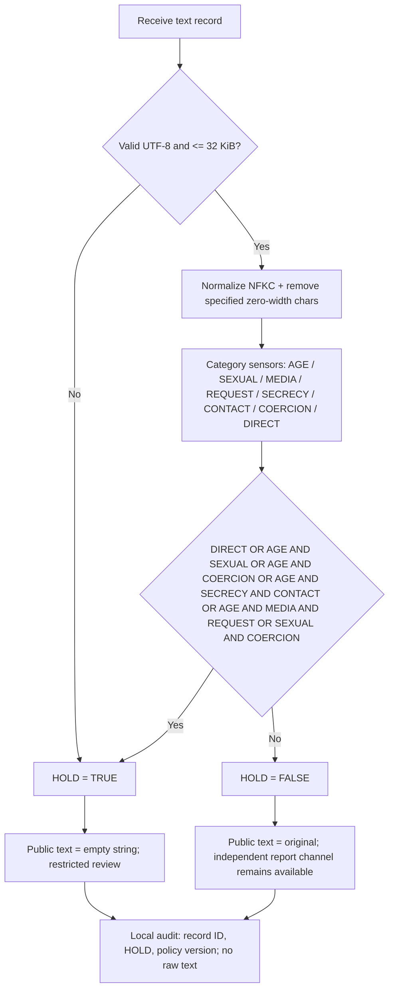

# Single-Bit Content Safety Gate (PLC evaluation edition)

> # FOR EVALUATION PURPOSES · NO WARRANTY · NO COPYRIGHT CLAIM · NO TRADEMARK CLAIM · NO INSURANCE · ONLY BEST EFFORT SELF DIRECTED AGENCY LOGIC
>
> This repository is an **experimental, limited English-language text triage example**, NOT a certified CSAM/CSAE detector, a legal compliance system, a substitute for trained human reviewers, or a guarantee that any public text is safe. Authors dedicate the original code/text they have the right to dedicate to the public domain to the extent possible (see `UNLICENSE`). **No warranty, insurance coverage, certification, indemnity, trademark ownership or government authorization is offered.** This notice does not nullify mandatory law, victims' rights, or third-party rights. No legal agency relationship is created.

**Status:** EVALUATION ONLY / NOT PRODUCTION CERTIFIED. User-provided political title retained in the draft bills. The governmental documents are **citizen proposals**, not enacted laws or official government material.

## One Boolean output: `HOLD`

The final public-output gate is **one Boolean**. All intermediate category matches are internal combinational inputs; the retained final decision is `HOLD` (true/false). No numeric risk scores, no numeric thresholds, and no second redaction decision are used.

```text
HOLD = INPUT_ERROR OR DIRECT
       OR (AGE AND SEXUAL)
       OR (AGE AND COERCION)
       OR (AGE AND SECRECY AND CONTACT)
       OR (AGE AND MEDIA AND REQUEST)
       OR (SEXUAL AND COERCION)
```

A `true` outcome sends the message to a **restricted local human-review workflow** and emits a public empty string `""` (NOT deletion of original). A `false` outcome leaves the text unchanged. The former intermediate word-by-word sanitization category is retired in this edition. **Neither output is a legal verdict.** A separate accessible user-reporting mechanism handles credible threats and actual knowledge even when `HOLD=false`.

### Public PLC logic-flow chart (limited, non-exhaustive)



### Boolean algebra and XOR safeguard

`A OR B` is equivalent to `(A XOR B) OR (A AND B)`. Do **not** replace an OR gate with XOR alone: simultaneous warning signals would cancel each other, a dangerous false negative. The implementation uses the simpler monotonic AND/OR form; XOR is retained in the public proof for auditability. This is algebraic simplification, **not** a claim of better detection accuracy.

### Truth table (single output)

| Example category state | `HOLD` | Public output |
|---|---|---|
| No gate matches, valid text | `false` | Original unchanged |
| `AGE AND SEXUAL` | `true` | `""` |
| `AGE AND SECRECY AND CONTACT` | `true` | `""` |
| `DIRECT` | `true` | `""` |
| Invalid or oversized record | `true` | `""` |

**Limitations:** It examines each supplied record, not entire conversations, attachments, videos, coded language, or all languages. A line-based archive is only correctly analyzed when one line equals one complete post. Normalization differs without required language runtime support. Technical failures must fail closed, but fail-closed filtering should not prevent an independent report or hotline from receiving an urgent user report.

## Implementations

- `powershell/Protect-Archive-SingleBit.ps1`: standalone PowerShell 7 local-only scan/rip/replace. Defaults to `all_threads_dump.txt` in the script directory. Produces a distinct sanitized text file and audit JSONL; does not send Datadog data. Original is never overwritten.
- `php/SingleBitGate.php` and `php/cgi-bin/post.php`: PHP 8+ core and CGI example. The CGI handler requires secure review storage and local metadata audit. Install the CGI handler in a correctly configured PHP CGI environment, not as a static downloadable script. PHP `intl` is recommended for full NFKC support; without it, non-ASCII input is held instead of being silently treated as safe.
- `ruby/app/services/single_bit_gate.rb`: Ruby 3+ service that can be dropped into Rails; `ruby/app/controllers/posts_controller.rb` shows a Rails integration scaffold with restricted review storage requirements.
- `tests/test_php.php` and `tests/test_ruby.rb`: harmless synthetic test cases and Boolean algebra consistency assertions.
- `policy/House_Bill_Draft.md`, `policy/Senate_Bill_Draft.md`, and `policy/US_CODE_CROSSWALK.md`: companion citizen drafts and current-law comparison.

### PowerShell 7 local evaluation

```powershell
# Put the script and UTF-8 archive together, then execute:
pwsh.exe -NoLogo -NoProfile -ExecutionPolicy Bypass -File .\Protect-Archive-SingleBit.ps1

# To explicitly name a different archive:
pwsh.exe -NoLogo -NoProfile -ExecutionPolicy Bypass -File .\Protect-Archive-SingleBit.ps1 -ArchivePath '.\posts.txt'

# Parent pwsh => cmd.exe => child pwsh:
& cmd.exe /d /c 'pwsh.exe -NoLogo -NoProfile -ExecutionPolicy Bypass -File ".\Protect-Archive-SingleBit.ps1"'
```

**Privacy and safety:** Do not put unreviewed raw archive text, victim details, URLs, images, or usernames into Datadog, CI, issues, GitHub commits, or ordinary logs. This release has **no Datadog network upload path**. Handle actual knowledge, evidence preservation, and NCMEC reporting independently under applicable law. Do not assume a keyword Boolean establishes criminality or that a blank public message may lawfully destroy retained evidence.

## Public-process commitment / change control

The public flowchart, exact Boolean expression, category definitions, release history and evaluation limitations must be available at a stable public URL. Version history remains accessible; updating does not erase previous versions. A proposed statutory requirement calls for a signed, dated agency re-attestation within 90 days after each new Congress convenes; **such a requirement would arise only if enacted**, and it would not force each new Congress itself to approve this algorithm. Historical versions should not be mistaken for the current version. Additional substantive logic changes require a new version and explicit evaluation; unlike-for-like experimental runs are not directly comparable.

## Public-domain intent and legal limits

See `UNLICENSE`. `NO COPYRIGHT` describes the author's intended waiver of rights they control, **not** a guarantee that no rights exist under every jurisdiction. `NO TRADEMARK` is a disclaimer of an assertion of rights by this project, not permission to misuse a third party's marks. `NO INSURANCE` means no coverage is being supplied. All participation, adoption, and publication decisions are self-directed, with no transferred legal responsibility. No affiliation with Datadog, GitHub, any U.S. agency, or JWICS is claimed.